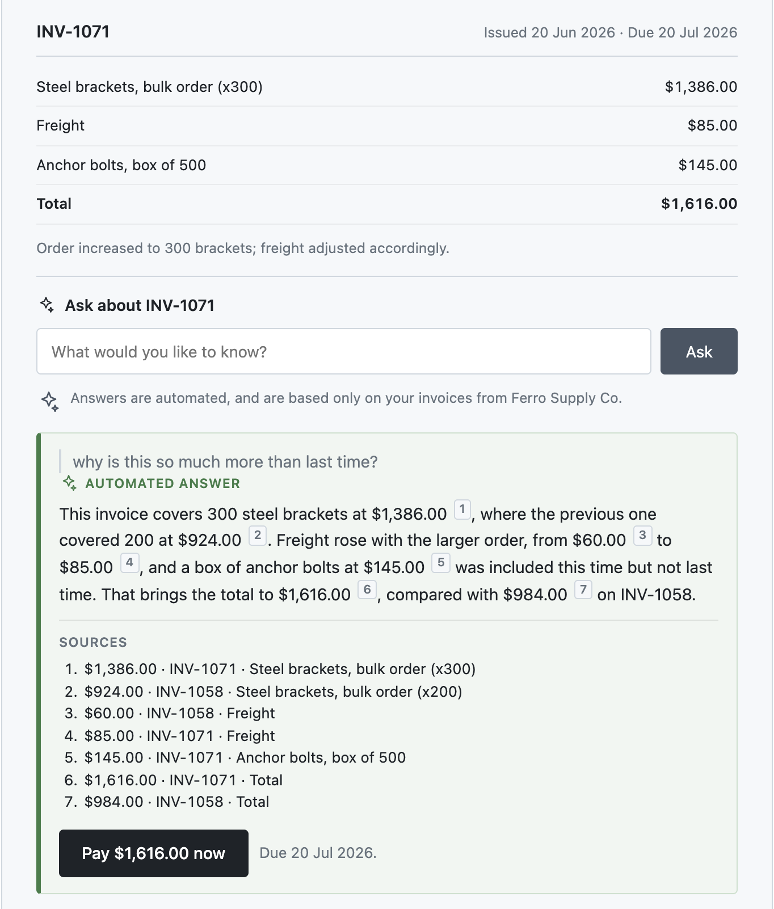

# Invoice Q&A prototype

This is a working prototype of a self-service Q&A feature for a customer-facing invoice portal. The end user (a payer) asks a plain-language question about their invoice and gets an answer **grounded in their invoice records**: where the data exists, every figure in the answer carries a citation to the invoice line it came from.



The point of this feature is to get invoices paid faster. People are slow to pay invoices they don't understand. Some will ask the merchant by email or phone and then wait; others mean to ask and never do, so the invoice sits unpaid and nobody ever hears the question. This answers it while the payer is still looking at the invoice, and offers the two things that move payment forward: pay now, or write to the merchant about whatever understanding the invoice can't settle.

Invoices are the specific context here, but the shape of the problem is general: open-ended questions asked by end users, and answers bounded by records the organisation already holds.

The prototype and the spec in [`docs/invoice_qa_feature_spec.md`](docs/invoice_qa_feature_spec.md) were built against each other, and both changed in the process. Further down, a table maps each acceptance criterion to the code that implements it and how to check it, and a [Governance](#governance) section does the same for disclosure, data handling and wrong answers.

---

## Why this repo exists

This is a proof of concept rather than a product. The data is entirely fictional and fixed. It was built with Claude Code to explore how a draft spec and a prototype develop against each other: the spec was drafted first, building against it tested the requirements, and the issues that surfaced went back into the spec.

Speed matters here. Building a prototype used to cost so much time and money that few product people had the luxury of doing it before handing a spec to engineering. But that 'finished' spec was typically only the starting point for a back-and-forth with engineering and other stakeholders to remove ambiguity and move, often slowly, towards clarity on the shape of the solution and its technical feasibility. Building a prototype like this one, for a new AI feature, takes a day or two at most, which makes it cheap enough to use for validating and clarifying the spec.

Working this way puts something running in front of customers, product architects and engineering leads while the spec is still a draft. What reaches engineering after a short validation loop is a spec whose product-side questions have already been answered.

---

## Run it

**Prerequisites:** Node 18+ and an Anthropic API key ([console.anthropic.com](https://console.anthropic.com/settings/keys)). The offline evals below need neither. A full evaluation session costs a few cents.

```bash
npm install
cp .env.example .env      # then paste your key into .env
npm start
```

Open <http://localhost:3000>.

The key is read server-side only and is never sent to the browser. If it's missing, the terminal warns you at startup, and any question comes back with a message naming the fix and no Retry button, since retrying cannot produce a key.

---

## What it does

Open an invoice and you see its line items, fees and total. Ask a question about it and the answer comes from that invoice's records, with each figure cited to the line it came from.

The question is always about the invoice on screen. There's no picker and no way to ask across the whole account, so an answer can never attach to the wrong invoice. Account-wide questions are a plausible second version.

The data is one fictional customer, Marrow & Co., buying industrial parts from Ferro Supply Co. Their invoice history is deliberately uneven so there's something to ask about: a late fee, an added line item, a supplier price rise, a larger order, one invoice flagged as contested, and one old enough to fall outside the 12-month retrieval window. The next section suggests where to start.

Each invoice also has a **Simulate a system failure** button, marked on screen as *Prototype control, not part of the feature*. It's there for testing only, and a real customer would never see it. One of the criteria is that an outage must look nothing like a decline, and the only way to check that is to look, so a reviewer needs a way to cause one on demand.

### How a question is handled

```
question
   │
   ├─ authorization check (code) ───────► generic "couldn't find that invoice"
   │
   ├─ classify the question (LLM)
   │
   ├─ act on the label (code)
   │      │
   │      ├─ dispute ───────────────────► never answered; offer a route to a person
   │      ├─ contact request ───────────► offer to write to the merchant
   │      ├─ cross-merchant ────────────► disclosed as out of scope
   │      └─ nothing actually asked ────► say what the assistant is for, and stop
   │
   ├─ retrieve (code, bounded to 12 months)
   │      │
   │      └─ named invoice missing ─────► declined, saying so if it's over 12 months old
   │
   ├─ write the answer (LLM)
   │
   └─ decide what's shown (code)
          │
          ├─ grounded ──────────────────► answer + inline citations
          ├─ no supporting records ─────► "can't answer confidently"
          └─ no prior invoice ──────────► "nothing earlier to compare"
```

An LLM is used twice, for two different jobs, and ordinary code does everything else:

- **Classifying the question.** The LLM returns a label, such as "dispute" or "factual", plus any invoice numbers the question names. It doesn't answer. Code then acts on the label. Disputes, contact requests, cross-merchant questions, messages that don't ask anything, and questions naming an invoice that wasn't retrieved are all settled in code, so they never reach the answering call.
- **Writing the answer.** The LLM works only from the invoices the code retrieved, and says whether they supported an answer. Code then decides what the customer sees: the answer with its citations or a decline, a note if older invoices were left out, and the options to pay or write to the merchant. Before an answer is shown, code checks every dollar figure in it against the citations, and declines if one has none.

**This is retrieval-augmented generation (RAG).** The code fetches the relevant invoices first, and the LLM is given only those records to answer from, not left to answer from general knowledge. The retrieval is a plain lookup, not a search by meaning (often called semantic or vector search). That kind of search suits loosely worded text such as help articles, where the right answer may not share words with the question. Invoices are structured records, so code can pick the right ones by customer, by date and by what the payer is allowed to see. A search by meaning would cost more and could fetch the wrong invoice, without finding anything a lookup misses. The spec explains why this approach was chosen over fine-tuning. 

Spotting a dispute is the LLM's job, but refusing to answer one is left to code, because in a financial context a confident wrong answer is worse than no answer.

In the prototype, both LLM calls use Claude. In production, either call could use a different LLM, and the two calls don't have to match. That could be a closed LLM or an open-weight one, large or small, run by the provider, in the platform's own cloud, or on hardware the platform runs itself. Where an LLM runs is also where payer data goes, so the choice has to follow the privacy laws and the rules on where data can be stored in every country the system is used in (see [Governance](#governance)). Each call has a small job: one labels the question, the other answers it from the records it's given. So swapping either LLM doesn't remove the guardrails. I haven't tested whether a smaller model is good enough for either job.

---

## Try it

The evals further down check the requirements automatically. This section contains some starting point suggestions for exploring the prototype.

### A quick tour

- Open **INV-1014** and ask *"why was I charged a late fee?"* You get an explanation from the invoice, with each figure linked to the line it came from.
- Open **INV-1071** and ask *"when will my next order ship?"* The invoice doesn't say, so it tells you it can't answer and offers to help you write to the merchant.
- Open **INV-1071** and say *"I never received this shipment, I want a refund."* It doesn't try to answer, and nothing is sent on your behalf. It explains that disputes are for the merchant and offers to help you write to them.
- Inside any invoice, click **Simulate a system failure** and compare what you see with the decline above.

### Then try to break it

The quick tour confirms the prototype does what the spec says. The bigger job is finding where the spec itself is wrong, and that only happens when people ask their own questions in their own words.

Push where the system has to make a judgement call:

- **Mix a question with a complaint.** *"Why was the freight so high? I want it refunded."* Anything that reads as a dispute isn't answered, even if it also asks something factual. Is that the right call?
- **Ask a follow-up.** Ask something, then *"and the one before that?"* Each question is answered on its own, with no memory of the last, so a follow-up that can't stand alone is declined. Would a customer expect that?
- **Start from a wrong assumption.** Open **INV-1042** and ask *"why did this go up?"* Nothing went up. Does it say so, or play along?
- **Ask something the invoice can't know.** *"What discount will you give me next quarter?"* That's a real question the records can't answer. Does it decline, or brush it off as small talk?
- **Just vent.** *"This supplier is useless."* There's no question in it, so it says what it's for and stops. It deliberately doesn't offer to forward what you wrote, since that would make it easy to send an angry message to a supplier you still have to deal with.
- **Say the same thing three ways.** Do the answers agree?

**What counts as a finding.** Anything that surprises you, including a response that follows the spec and still feels wrong. Note the invoice, what you asked, and what you expected. Several of the spec's twelve changes started exactly like that. In one, a customer asking about a late fee got a correct answer and was then offered only a conversation with the merchant, on an invoice they could have paid in one click. The system was working as specified, so the change went into the spec as AC13, which now has eval cases to keep it in place. [`docs/decisions.md`](docs/decisions.md) records all twelve changes.

---

## Where each requirement lives

| Spec | Requirement | Code | How to check |
|---|---|---|---|
| **AC1** | Answers cite every figure | `server.js` → `answer()`, `ANSWER_SCHEMA`; `lib/core.js` → `decidePostAnswer()`, `uncitedFigures()` | INV-1014 by hand; OFF-15, OFF-31 |
| **AC2** | Declines when the records can't answer | `lib/core.js` → `decideRetrieved()`, `decidePostAnswer()` | INV-1071 by hand; OFF-27 |
| **AC3** | Says when there's nothing earlier to compare | `lib/core.js` → `decidePostAnswer()` | INV-1001 by hand |
| **AC4** | Never answers a dispute | `lib/core.js` → `decidePreAnswer()` | INV-1071 by hand; OFF-01, OFF-02 |
| **AC5** | An outage looks unlike a decline | `server.js` catch → `app.js` retry counter | Failure button; ON-18 |
| **AC6** | Checks ownership before retrieval | `lib/core.js` → `authorizeInvoice()`, `payerVisible()` | OFF-19, ON-20, ON-26 (stubbed) |
| **AC7** | Only the invoice on screen | `app.js` → `askPanel()` | DOM-13 |
| **AC8** | Switching invoice clears the answer | `app.js` → `select()`, `drafts`, `clearDraft()` | DOM-03 to DOM-06 |
| **AC9** | Answers labelled as automated | `index.html` → `.disclosure`; `app.js` → `labelFor()` | DOM-11 |
| **AC10** | One route to a person | `server.js` → `/api/route-to-merchant`; `app.js` → `routeAction()` | Any invoice by hand |
| **AC11** | Confirmed only when accepted | `server.js` → `/api/route-to-merchant`; `app.js` → `send()` catch | ON-14, ON-15, DOM-08 |
| **AC12** | Nothing sent without a choice | `app.js` → nothing fires without a click | ON-17, DOM-07 |
| **AC13** | Pay offered on unpaid invoices | `lib/core.js` → `offersPayment()`, `paymentIsPrimary()` | OFF-20, DOM-09, DOM-12 |
| **AC14** | Confirm before sending, never twice | `server.js` → dedupe guard; `app.js` → `confirmStep()`, `sentList()` | ON-21, DOM-01, DOM-02, DOM-07 |
| Non-Goal | 12-month history window | `lib/core.js` → `windowCutoff()`, `decidePreAnswer()`, `decideRetrieved()`, `decidePostAnswer()` | INV-1071 by hand; OFF-08, OFF-25, OFF-26, OFF-29, OFF-30 |
| Non-Goal | Other merchants out of scope | `lib/core.js` → `decidePreAnswer()` | Any invoice by hand |
| Edge case | Partial data means a decline | `lib/core.js` → `decideRetrieved()`; `answer()` system prompt, rule 3 | OFF-27, OFF-28, ON-25 |
| Edge case | Oversized input is rejected | `server.js` → `MAX_QUESTION_CHARS`, `MAX_MESSAGE_CHARS` | ON-27, ON-28 |

---

## Evals
The evals are 66 cases, each pairing a question or situation with what an acceptable response looks like. Because the LLM's wording varies from run to run, they check properties of a response, such as whether every figure is cited, not its exact text. There are two sets.

```bash
npm install && npm run eval:offline    # 40 evals, no API key or server needed, runs in seconds
npm run eval                           # all 66, including 26 against the running app (needs a key and the server running)
```

**Offline: the rules that don't depend on the LLM.** Some behaviour is fixed in code: a dispute never reaches the answering call, nothing older than 12 months is retrieved alongside the invoice on screen, the merchant's internal notes are stripped before anything reaches the screen or the LLM, a disputed invoice never offers a Pay button, and an answer containing a figure with no citation is declined. These evals run without calling the LLM. They feed the code fixed stand-ins for what the LLM would return, such as a question pre-labelled as a dispute or a reply that declines, and check the code handles each correctly, so these rules hold whatever the LLM says.

Thirteen of them load the page in a simulated browser (jsdom) and click through it. Three bugs found by hand in one afternoon were all combinations of rules that were each fine on their own, so these check guarantees across every combination: a sent message shows exactly once, a second message never replaces the first, typed text is never lost unless the customer deletes it, and an answer always belongs to the invoice on screen. [`evals/state-model.md`](evals/state-model.md) sets out the combinations and [`evals/dom.js`](evals/dom.js) tests them.

**Online: what the LLM actually did.** Nineteen evals send a question end to end through the app and the live LLM and check what comes back: figures cited, declines where it can't answer, disputes recognised. One checks that an oversized question is rejected before it gets that far. Six more test sending a message to the merchant. A pass means it behaved on this run, not that it always will.

```
  PASS  OFF-01  AC4      Dispute intent never reaches the answer path
  PASS  OFF-08  Window   Retrieval is bounded to the 12-month window
  PASS  OFF-15  AC1      Groundedness check catches an uncited figure
  PASS  DOM-01  INV1     The sent record appears exactly once, in every state
  PASS  DOM-09  INV6     Payment and routing match the state model, in order
  ...
  40/40 passed
```

Each case is tagged with the acceptance criterion it covers, in [`evals/cases.json`](evals/cases.json). The table above maps criteria to cases.

**Check the evals can fail.** Change the dispute check in `lib/core.js` to `if (false)` and run the offline set. OFF-01 and OFF-02 fail and give the reason.

**What a green run doesn't tell you.**

- Whether an answer reads well or is useful. That needs a person; see "Try it".
- Whether a figure is cited to the *right* line. The check confirms each figure has a citation, not that the citation matches the records. Code could verify that, and a production version should.
- Whether a figure in another currency is checked. The check looks for dollar amounts, so a £ or € figure, or a number with no currency sign, would pass.
- Whether anything other than a money figure is right. A wrong date or status would pass.
- Whether it holds up against deliberate misuse. No eval tries to talk the assistant out of its rules.
- Whether it's ready to release. The spec's release gate is a golden set of at least 50 questions, run in CI before any prompt, LLM or retrieval change ships, with at least 99% of facts traced to a source. These 66 are run manually, not in CI.

When exploring turns up a problem with the spec, the fix gets a case here, so it can't quietly break again.

---

## How the spec was produced

The spec was drafted first, then put through [`pm-spec-workflow`](https://github.com/J-Hunniford/pm-spec-workflow), a spec review tool I built in Claude Code (private repo). Up to eight AI reviewers read it in parallel, each checking one thing: whether the criteria can be tested, whether the scope is clear, whether the language is vague, whether edge cases are covered, and so on. Their findings become a short set of questions for the PM. The reviewers only judge; a separate step rewrites the spec once those questions are answered.

**The spec then changed twelve more times, most of them prompted by building the prototype.** A review is good at spotting requirements that can't be tested. It's much worse at spotting ones that are testable and simply wrong, and building the feature finds those. The clearest example: AC4 told the customer their dispute had been flagged for the merchant's support team, when nothing had been sent anywhere. A developer would have built exactly that, and every customer raising a dispute would have been told something untrue.

These were mistakes in the requirements, not the code. Finding them at this stage costs hours; finding them after engineering has built to the spec costs weeks. [`docs/decisions.md`](docs/decisions.md) lists all twelve changes.

---

## What's stubbed, and what's real

Everything listed under *Where each requirement lives* is real code. These are the places where the prototype stands in for something the real platform would provide.

**Authorization.** There's only one hardcoded customer, so `authorizeInvoice()` can't do a real ownership check. It still runs before anything is retrieved, and the message it gives, "couldn't find that invoice", never confirms whether an invoice exists. In production it would compare the invoice's customer with the logged-in one.

**Not built.** Two things a production version would change. The customer's name is sent to the LLM with every answer call, and production should ask whether it's needed. The server also accepts two test hooks from any request, `simulateFailure` and `simulateUnavailable`, which would be removed.

**Retrieval.** The data is a fixed JSON file, so retrieval is a simple filter and nothing is saved when the server restarts. A production version would use a database.

**Payment.** Taking payment is a Non-Goal. The Pay button in the Q&A sends you to the payment panel on the right, which stands in for the portal's own payment flow, and highlights it. Press that panel's button and it tells you payment is out of scope for the prototype.

**The invoice view.** It's deliberately basic, and only there so the Q&A has an invoice to sit inside.

**The feature name.** "Ask" is a placeholder. Naming a customer-facing feature is a decision for product, marketing and leadership after a proof of concept, which is why no name appears in the acceptance criteria.

**LLM choice.** Both calls use `claude-opus-5`, with the classifying call set to low effort because it's a narrow labelling task.

Product decisions live in the spec, not here. What v1 leaves out is in its Non-Goals, and what's still undecided, such as which system delivers messages to the merchant, is in its Open Questions.

---
## Governance

This feature puts an LLM between a business and the people who owe it money, so AI governance questions are upfront requirements, not a review at the end. Most of the answers are already acceptance criteria with evals behind them. This section gathers the key points in one place and calls out what would need to be resolved before launching a feature like this one.

**Why use an LLM at all.** It's a fair question, and for parts of this feature the answer is that you don't need one. The LLM does two jobs here. It works out what a payer is asking, however they word it, and it writes the reply. Ordinary code can't do either well. Everything else is code: fetching the records, checking that every dollar figure has a citation, refusing to answer disputes, and deciding what the payer sees. The LLM can't act on anything. It can't change an invoice, send a message or take a payment, so the worst it can do is say something wrong.

That risk is real, because a business can be held to what its assistant tells a customer. Code checks the dollar figures, but not dates, statuses or a sentence like "no late fee will be added". A production version should go further and have code work out the facts, such as what changed between two invoices, leaving the LLM only to put them into words. A company could also reasonably decide that some common questions don't need an LLM, and answer those from a template.

**Which rules apply depends on where the payers are, and that isn't decided here.** The EU AI Act applies to a company that offers an AI system in the EU, and to one based elsewhere if what the system produces is used in the EU. So payers in the EU would bring this feature under it. UK payers are covered by UK GDPR whatever happens with the AI Act, and the regulator there is the ICO. In the US, state privacy laws and state AI disclosure laws would need checking, and they vary by state. Building to the Act's standard makes sense either way, given that it is currently one of the strictest legal frameworks for AI governance, so meeting it is likely to cover most of what other markets ask. A feature like this one carries few obligations under the Act, and its standards are easier to meet from the start than later.

**What the Act would ask for.** This feature answers questions from records. It doesn't make decisions about the payer, so it isn't one of the uses the Act bans or treats as high-risk. That leaves two duties: tell people they're dealing with an AI system (Article 50), and make sure the staff who run it understand it (Article 4). The LLM provider has separate duties of its own.

**Automated decisions.** UK and EU data protection law also has rules on decisions made about a person by automated means alone, where the decision significantly affects them (Article 22 of GDPR, which the UK reworked in the Data (Use and Access) Act 2025). This feature stays clear of those rules because it decides nothing. It can't approve, refuse or change anything on an account, and anything that needs a decision, such as a dispute, goes to a person.

If this feature developed further to use the questions to predict who will pay late, that could count as assessing creditworthiness, which the Act does treat as high-risk when the payer is a person, such as a sole trader. The feature doesn't do this, and it's an open question in the spec.

The table below takes each governance question in turn. It shows what the prototype does today, where to check that in the code or the evals, and what a real launch would still need. None of the last column is built.

| Question | What the prototype does | Where to check | Still needed before launch |
|---|---|---|---|
| Does the payer know it's AI? | A permanent notice on the panel, and a label on every answer so it survives a screenshot. Both say "automated", not "AI" | AC9; DOM-11 | A decision on whether "automated" is clear enough, since the Act expects people to be told it's an AI system. Legal confirmation of wording and placement in each market |
| Can software tell the answers are AI-generated? | No. The label is text for people to read | AC9 | A legal view on whether the Act's rule on marking AI-generated content covers these answers |
| Can a payer see someone else's invoice? | The check runs before any records are fetched and before a message is sent to the merchant, and a miss never confirms whether an invoice exists. There's only one hardcoded customer, so it can't yet check whose invoice it is | AC6; `authorizeInvoice()`; ON-26 | A real ownership check against the logged-in customer, on every endpoint |
| What leaves the platform? | Each question goes to an outside LLM provider with the customer and merchant names and the invoice fields the payer is entitled to see. The merchant's internal notes are removed before retrieval returns, so the LLM never has them | `payerVisible()`; OFF-19, ON-20 | The data protection roles written down. The merchant would most likely be the controller, which decides why payer data is used. The platform would be its processor, and the LLM provider, if it's an outside one, a sub-processor. A lawful basis for the processing. A contract with the provider, confirmation it doesn't train on the data, a lawful route if data crosses borders, a check on any rules about where it has to be stored, a line in the privacy notice, and a data protection impact assessment (DPIA) before launch. For UK and EU payers, GDPR sets the terms |
| What if a payer types something personal? | It goes to the LLM provider as typed. Nothing filters it, though a question is capped at 500 characters | `classify()` and `answer()` in `server.js`; ON-27 | A decision: filter it, warn the payer, or accept it and say so in the privacy notice |
| What if an answer is wrong? | Every figure has to carry a citation, and code declines any answer with a dollar figure that has none. It declines when the records don't support an answer, and it never answers a dispute | AC1, AC2, AC4; OFF-01, OFF-15, OFF-27, OFF-31 | A named owner, reviewed samples of live answers, the release gate running in CI, and on-screen wording that says an answer can be wrong and how to query it |
| What are the questions used for? | Only to answer the person asking. The prototype doesn't store them, and query history doesn't change what a payer is told | Non-Goals, *Behavioural targeting* | A retention policy, a way for a payer to get a copy of their stored questions or have them deleted, and a decision on any other use before it starts, not after |
| Where do sent messages end up? | The customer's record of what they sent is kept on purpose (AC14), in the browser for this prototype. The server keeps no message text. It logs that a message was sent, with the merchant and invoice reference, and the duplicate-send check stores a fingerprint of the message, not the message. A fingerprint can still count as personal data under GDPR, so it is deleted after 60 seconds | `/api/route-to-merchant` in `server.js`; `sentToMerchant` in `app.js` | The customer's record stored properly, with a retention period and access rules. A retention period for the server log too, since an invoice reference can point to a person |
| Do the people running it understand it? | Not applicable to a prototype | | Training for the staff who operate the feature and review its answers |

Notes on three of the above points.

**What the LLM is sent.** The LLM is called twice. The first call works out what kind of question it is, and gets the question but not the invoice. The second call writes the answer, and gets the customer and merchant names and only the invoice details the payer can already see on their own screen. The merchant's internal notes are never sent. So if a payer tries to trick the assistant into revealing them, there is nothing for it to reveal. The code sends only fields on an approved list. If a new field is added to an invoice later, it isn't sent until someone adds it to that list.

**Storing questions.** The prototype doesn't save the questions payers ask. A real version would have to, because nobody can check whether an answer was right if it wasn't kept. So the privacy notice shouldn't say that nothing is stored. It should say that questions are kept, and used only to answer them and to check the answers.

**Other uses for the questions.** The questions could be used in two more ways, and neither is decided. The first is to look at all the questions together to see which charges confuse people, and then make the invoice clearer. That carries little risk. The second is to look at one payer's questions to predict whether they will pay late. That is profiling, and the EU AI Act may treat it as high-risk. Payers would need to be told and given a way to opt out, and it would need its own review first. This is an open question in the spec.

---
## Layout

```
invoice-qa-prototype/
├── server.js                        # web server and both LLM calls
├── lib/
│   └── core.js                      # the rules, as pure functions (testable without the LLM)
├── public/                          # the single-page interface
│   ├── index.html
│   ├── app.js                       # screen states, retry logic, message writing
│   └── styles.css
├── evals/
│   ├── run.js                       # runs the offline and online evals
│   ├── cases.json                   # eval cases, each tagged with its acceptance criterion
│   ├── dom.js                       # tests the state model in a simulated browser (jsdom)
│   └── state-model.md               # what the browser must show, in every combination
├── data/
│   └── synthetic_invoice_data.json  # the fictional invoices, test questions and notes
└── docs/
    ├── invoice_qa_feature_spec.md   # the spec
    ├── decisions.md                 # what changed in the spec, and why
    └── answer-with-citations.png    # the screenshot at the top of this README
```

`data/synthetic_invoice_data.json` includes a `test_notes` section saying which invoice to open for the less obvious questions, and what each one is meant to show. Worth a look before you start exploring.

